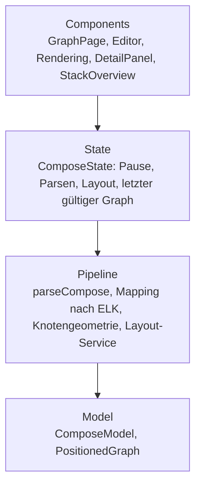
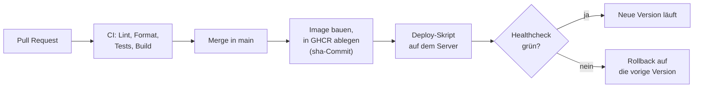

# Case Study StackGraph

Eigene Seite unter `/de/projekte/stackgraph`. Zielgruppe sind vor allem Tech Leads und Entwickler. Einstieg und Problem sind so geschrieben, dass auch HR sie versteht. Ab der Architektur wird es technisch. Keine direkte Anrede.

Kompakte deutsche Fassung der englischen About-Seite von StackGraph, mit ausführlicherem Teil „Betrieb“ (entschieden am 22.11.).

Stand: 22.11.2026 · Status: Entwurf

## Kopf

- **Kicker:** Case Study
- **Titel:** StackGraph
- **Unterzeile:** Ein Werkzeug, das eine `docker-compose.yml` als interaktiven Graphen zeigt: welche Dienste es gibt, wie sie voneinander abhängen und wo ihre Daten liegen. Es läuft komplett im Browser, nichts wird hochgeladen.
- **Aktionen:** StackGraph ausprobieren (https://stackgraph.tobias-klanert.de) · Quellcode auf GitHub (https://github.com/TobiasKlanert/stackgraph)

## Steckbrief

| Feld     | Wert                                                                                                                       |
| -------- | -------------------------------------------------------------------------------------------------------------------------- |
| Rolle    | Alleinprojekt: Idee, Design, Entwicklung, Betrieb                                                                          |
| Zeitraum | seit 07/2026, v1.0.0 am 12.10.2026                                                                                         |
| Status   | Live seit 10/2026 (v1.0.2), v1.1 geplant                                                                                   |
| Stack    | Angular 21, TypeScript 5.9 (strict), Signals, RxJS, ELK.js, d3-zoom, js-yaml, Vitest, Docker, nginx, GitHub Actions, Caddy |
| Live     | https://stackgraph.tobias-klanert.de                                                                                       |
| Repo     | https://github.com/TobiasKlanert/stackgraph                                                                                |
| Details  | https://stackgraph.tobias-klanert.de/about (Englisch)                                                                      |

## 1. Problem

Viele Anwendungen bestehen aus mehreren Bausteinen: ein Webserver, eine Datenbank, ein Cache, ein Hintergrunddienst. Mit Docker Compose beschreibt man sie in einer einzigen Textdatei. Je länger diese Datei wird, desto schwerer ist zu erkennen, was eigentlich passiert. Welcher Dienst hängt von der Datenbank ab? Welche Dienste teilen sich ein Netzwerk? Wo werden Daten dauerhaft gespeichert? Die Antworten stehen alle in der Datei, aber verteilt über Dutzende eingerückte Zeilen. Ein Graph zeigt sie auf einen Blick.

Ich arbeite selbst viel mit Docker Compose und bin immer wieder an diesem Punkt hängen geblieben. Nach der Weiterbildung wollte ich außerdem ein Projekt, das ganz von mir stammt, keine Kursaufgabe und kein nachgebautes Tutorial. StackGraph ist deshalb drei Dinge zugleich: ein Werkzeug, das ich selbst haben wollte, ein Lernprojekt und ein Projekt für mein Portfolio.

Das Lernen war Absicht. „Parser“ war für mich lange ein Wort, das ich benutzt habe, ohne genau zu wissen, was dahintersteckt. Deshalb habe ich den Teil, auf den es hier ankommt, selbst gebaut. Und zum ersten Mal habe ich eine Architektur entworfen, bevor ich Feature-Code geschrieben habe, statt die Struktur nebenher wachsen zu lassen.

### Anforderungen

Fünf Anforderungen haben fast jede technische Entscheidung geprägt. Jede davon hat etwas ausgeschlossen.

- **Nichts verlässt den Browser.** Compose-Dateien enthalten oft interne Hostnamen und manchmal Zugangsdaten. Deshalb gibt es kein Backend, keinen Upload, keine Statistik, und selbst die Schriften liegen auf dem eigenen Server. Jede Abhängigkeit muss ihr Gewicht im Bundle rechtfertigen.
- **Rückmeldung beim Tippen.** Der Graph folgt dem Editor ohne Button. Halb getipptes YAML ist meist ungültig, also darf der Graph nicht bei jedem Tastendruck verschwinden.
- **Fehler, mit denen man etwas anfangen kann.** Jeder Fehler nennt Ursache und Stelle, bei häufigen Fehlern auch einen Hinweis zur Lösung.
- **Ein Layout, das Richtung zeigt.** Abhängigkeiten bilden meist Schichten, vom Proxy bis zur Datenbank. Das Layout soll diese Reihenfolge sichtbar machen, und das Ergebnis soll sich als sauberes SVG exportieren lassen.
- **Barrierefreiheit gehört zu v1.** Alles, was der Graph zeigt, muss auch per Tastatur und Screenreader erreichbar sein. Keine Information hängt allein an der Farbe.

## 2. Lösung

### Einfügen und sofort Rückmeldung bekommen

- Ein Editor mit Zeilennummern. Sobald das Tippen pausiert, folgt der Graph.
- Fehler sagen, was falsch ist und wo, mit Hinweis zur Lösung und einem Button „Go to line“. Währenddessen zeigt der Graph den letzten gültigen Stand und sagt das auch.
- Ein Klick lädt ein Beispiel, `Strg+Enter` (`⌘+Enter` auf dem Mac) öffnet den Graphen.

### Den Stack lesen

- Dienste sind Knoten, `depends_on` sind Pfeile, Netzwerke und Volumes eigene Knoten, Ports kleine Chips am Dienst. Das Layout läuft von oben nach unten, Abhängigkeiten zeigen also immer in eine Richtung.
- Knotentypen unterscheiden sich durch Form und Linienstil, nicht nur durch Farbe.
- Ein ausgewählter Dienst zeigt Image, Ports, Netzwerke, Volumes und Bind Mounts, wovon er abhängt und wer ihn braucht.
- Ohne Auswahl listet die Seitenleiste den ganzen Stack als Text. Das ist zugleich die Textalternative zum Graphen.
- Zoomen und Verschieben mit Maus, Touch oder eigenen Buttons.

### Mitnehmen

- Export als SVG, so gestylt wie auf dem Bildschirm.
- Helles und dunkles Theme, auf dem Handy getrennte Tabs für Editor und Graph.

### Bilder

| Datei (aus dem StackGraph-Repo, `docs/images/`) | Alternativtext                                                                                                                                 |
| ----------------------------------------------- | ---------------------------------------------------------------------------------------------------------------------------------------------- |
| `split-view-light.png`, `split-view-dark.png`   | Die Ansicht von StackGraph: links die Compose-Datei im Editor, in der Mitte der Graph mit dem ausgewählten Dienst „api“, rechts seine Details. |
| `phone-light.png`, `phone-dark.png`             | StackGraph auf dem Handy: oben die Tabs „Editor“ und „Graph“, darunter der Graph, unten die eingeklappten Details.                             |

## 3. Architektur

### So läuft eine Änderung durch

Jede Eingabe durchläuft dieselbe kurze Pipeline. Jeder Schritt gibt ein typisiertes Ergebnis an den nächsten weiter.

1. **Auf eine Pause warten.** Erst wenn 300 ms nicht getippt wurde, beginnt die Arbeit. Ein neuer Tastendruck verwirft, was noch aussteht. Ein Layout, das zu spät fertig wird, wird ignoriert und kann nie ein neueres überschreiben.
2. **In ein typisiertes Modell parsen.** js-yaml liest die YAML-Syntax. Alles danach ist eigener Code: `parseCompose` prüft den Baum und macht daraus ein `ComposeModel`. Kurz- und Langschreibweisen landen in derselben Form, Fehler werden über die ganze Datei gesammelt. Das Ergebnis ist entweder ein gültiges Modell oder eine Liste von Fehlern, nie etwas dazwischen („parse, don't validate“).
3. **Das Layout berechnen.** Eine reine Funktion übersetzt das Modell in das Format von ELK (Eclipse Layout Kernel). Dessen geschichteter Algorithmus ordnet den Graphen von oben nach unten. ELK wird erst bei der ersten Nutzung geladen.
4. **Den Graphen zeichnen.** Angular bindet die Knoten und Kanten direkt an SVG-Elemente, ohne Graph-Bibliothek dazwischen. d3-zoom berechnet nur Zoom und Verschiebung, Angular wendet sie an.
5. **Den letzten guten Graphen behalten.** Solange die Eingabe ungültig ist, bleibt der letzte gültige Graph stehen. Ein leerer Editor ist dagegen Absicht, kein Fehler, und leert den Graphen.

### Vier Schichten, eine Richtung

Abhängigkeiten zeigen nur nach unten. Der Kern von StackGraph weiß nicht, dass es Angular-Komponenten gibt.

Textalternative zum Diagramm:

- **Model:** reine TypeScript-Typen, `ComposeModel` aus dem Parser und `PositionedGraph` aus dem Layout. Sie sind der eigentliche Vertrag zwischen den Schichten.
- **Pipeline:** größtenteils reine Funktionen ohne Angular. Angular kommt nur dort vor, wo eine Browser- oder Bibliotheks-API es verlangt, etwa im `Layout`-Service um ELK herum.
- **State:** `ComposeState` ist der einzige Ort, der Parser und Layout verbindet. Hier liegt alles, was mit Zeit zu tun hat. Komponenten lesen nur seine Signals.
- **Components:** ein Container (`GraphPage`) hält Zustand und Auswahl, alle anderen Komponenten bekommen Inputs und melden Outputs. Graph und Textalternative sind zwei unabhängige Sichten auf dasselbe Modell.

Der Gewinn: Parser, Mapping und Geometrie lassen sich als einfache Funktionen testen, ohne Komponente und ohne DOM. Der Preis: Der positionierte Graph baut auf den Typen von ELK auf. Wer ELK austauscht, müsste auch den Renderer anfassen.

### Signals und RxJS

Signals tragen den Zustand. RxJS kommt nur dort zum Einsatz, wo Zeit eine Rolle spielt: die Pause vor dem Parsen, das Verwerfen veralteter Layouts und die verzögerte Anzeige „Updating…“.

### Vier Entscheidungen

**ELK und eigenes SVG statt einer fertigen Graph-Komponente.** Zur Wahl standen ngx-graph, D3 und ELK nur für die Positionen. Ich habe mich für ELK mit selbst gezeichnetem SVG entschieden. ELK berechnet Positionen und rechtwinklige Kantenverläufe, alles auf dem Bildschirm ist Markup, das ich kontrolliere. Erst dadurch sind Dienste als Toggle-Buttons mit `aria-pressed` möglich, getrennte Darstellung für Fokus und Auswahl und ein Export, der genau das enthält, was zu sehen ist. Der Preis ist mehr eigener Code. Für ein Produkt unter Termindruck wäre ngx-graph die vernünftige Wahl gewesen. Für ein Lernprojekt war genau dieser Code der Sinn der Sache.

**Ein ehrliches Ergebnis und ein getrenntes Gedächtnis.** Der Zustand beschreibt immer nur die aktuelle Eingabe: leer, wartend, fehlerhaft oder fertig. Ein `linkedSignal` darüber merkt sich den letzten fertigen Graphen, solange die Eingabe kaputt ist. So bleibt die Pipeline ohne Vorgeschichte testbar, und die Merk-Regel ist ein benannter Schritt statt einer Regel, die über die App verteilt ist.

**Knotengrößen berechnet statt gemessen.** ELK braucht die Größe jedes Knotens, bevor es etwas platzieren kann. Statt zu rendern und nachzumessen, berechnet eine reine Funktion die Größen aus dem Text. Bei der Monospace-Schrift ist das exakt, beim Namen bewusst großzügig geschätzt. Dasselbe Geometrie-Modul sagt ELK, wie groß ein Knoten ist, und den Komponenten, wo sie seine Teile zeichnen. Layout und Darstellung können nicht auseinanderlaufen.

**Der Web Worker kann warten.** Geplant war, ELK in einem Web Worker laufen zu lassen. Ich habe es für v1 verschoben und vorher gemessen: etwa 10 ms für 5 Dienste, 36 ms für 20, eine Viertelsekunde für 50 und mehr als eine Sekunde für 100 (Median aus 30 Läufen, synthetische Dateien). Für typische Dateien reicht das. Der Worker steht ganz oben auf der Liste für v1.1, und diese Zahlen sind die Messlatte.

### Qualität

- TypeScript `strict`, zusätzlich `noUncheckedIndexedAccess` und `exactOptionalPropertyTypes`, weil der Parser mit fremden Eingaben arbeitet.
- Tests mit Vitest und jsdom. Die reinen Funktionen im Kern brauchen kein Angular-Test-Setup.
- ESLint und Prettier. Lint, Format-Check, Tests und Produktions-Build müssen grün sein, bevor ein Pull Request gemergt werden kann. Der Build schlägt fehl, wenn das initiale Bundle größer als 1 MB wird.

## 4. Betrieb

StackGraph läuft auf meinem eigenen Server, hinter Caddy als Reverse Proxy. Ein Compose-Visualisierer, deployt mit Compose.

### Der Weg vom Pull Request zum Server

Textalternative zum Diagramm: Ein Pull Request durchläuft die CI mit Lint, Format-Check, Tests und Build. Nach dem Merge in `main` baut GitHub Actions das Image und legt es mit dem Commit-Hash als Tag in der GitHub Container Registry ab. Danach ruft GitHub das Deploy-Skript auf dem Server auf. Wird der Container gesund, läuft die neue Version. Sonst rollt das Skript auf die vorige Version zurück.

### Container

- **Multi-Stage-Build:** Node baut die App, ausgeliefert wird nur das Ergebnis in einem kleinen nginx-Image. Node ist auf eine exakte Version gepinnt, nginx auf eine feste Minor-Version.
- **Ohne Root-Rechte:** nginx läuft in der `nginx-unprivileged`-Variante als normaler Benutzer.
- **Gehärtet:** schreibgeschütztes Dateisystem (nur `/tmp` ist beschreibbar), alle Linux-Capabilities entzogen, `no-new-privileges`, begrenzte Log-Dateien.
- **Healthcheck:** Der Container meldet selbst, ob nginx antwortet. Darauf wartet das Deploy-Skript, bevor es einen Deploy als erfolgreich wertet.

### Deploy: GitHub darf klingeln, der Server entscheidet

GitHub bekommt keinen Zugang zum Server, sondern nur einen Klingelknopf. Der SSH-Key der Pipeline ist auf dem Server an einen einzigen Befehl gebunden, das Deploy-Skript. GitHub darf nur sagen, welches Image es möchte. Was dann passiert, legt der Server fest:

1. Das Skript akzeptiert nur ein Image-Tag in der Form `sha-` plus vollständiger Commit-Hash. Alles andere lehnt es ab.
2. Es lädt das Image zuerst. Gibt es das Image nicht, ändert sich auf dem Server nichts.
3. Es merkt sich, welche Version gerade läuft.
4. Es startet die neue Version und wartet bis zu 90 Sekunden auf einen grünen Healthcheck.
5. Wird der Container nicht gesund, startet es die vorige Version wieder und meldet den Deploy als fehlgeschlagen.
6. Zum Schluss räumt es alte StackGraph-Images auf, die Images anderer Projekte auf dem Server bleiben unberührt.

Weitere Sicherungen in der Pipeline:

- Nur `main` darf in die Umgebung `production` deployen.
- Die Pipeline prüft den Host-Key des Servers. Gibt sich ein anderer Rechner als mein Server aus, bricht der Deploy ab.
- Alle GitHub Actions sind auf Commit-Hashes gepinnt, nicht auf Versionsnummern. Dependabot schlägt Updates vor, frühestens sieben Tage nach einem Release.
- Jeder Job hat nur die Rechte, die er braucht. Der Deploy-Job hat gar keine.
- Ein Rollback ist jederzeit möglich, weil jedes Image in der Registry bleibt: einen älteren Deploy-Lauf in GitHub neu starten, fertig.

## 5. Learnings

### Ein Deploy-Zugang, der viel zu viel konnte

Bis Ende Oktober hat StackGraph anders deployt. GitHub Actions hat sich per SSH mit einem normalen Key als mein Benutzer angemeldet und eine Liste von Befehlen ausgeführt. Der Host-Key des Servers wurde dabei nicht geprüft, die Actions waren nur über Versionsnummern eingebunden, und es gab weder Healthcheck noch Rollback.

Funktioniert hat das drei Monate lang einwandfrei. Erst beim Aufbau der Pipeline für dieses Portfolio ist mir aufgefallen, was dieser Key eigentlich konnte: eine volle Shell auf meinem Server, und über die Docker-Gruppe praktisch Root-Rechte. Wäre der Key in falsche Hände geraten, hätte jemand den ganzen Server übernehmen können, nicht nur StackGraph.

Am 30.10. habe ich StackGraph auf das Muster des Portfolios umgestellt: beschränkter Key, Deploy-Skript, Healthcheck, Rollback. Danach habe ich den alten Key gelöscht, auf dem Server, in GitHub und auf meinem Laptop. Was ich mitnehme: „Es funktioniert“ heißt nicht „es ist sicher“. Ein Deploy-Zugang soll genau das können, was ein Deploy braucht, und nichts darüber hinaus.

### Ein fehlgeschlagenes Layout, das den Editor stummgeschaltet hat

In einer frühen Version ist ein einziges fehlgeschlagenes Layout bis in den äußeren RxJS-Stream durchgereicht worden. In RxJS beendet ein Fehler den Stream, den er erreicht. Danach hat der Editor den Graphen nicht mehr aktualisiert, ohne Fehlermeldung und ohne Absturz. Die Lösung war, Fehler innerhalb des `switchMap` abzufangen, sodass ein Fehler nur diesen einen Durchlauf beendet. Seitdem frage ich bei jeder Operator-Kette: Welchen Stream beendet dieser Fehler?

### Ein Test, der aus dem falschen Grund grün war

Ein Test sollte prüfen, dass ein geleerter Editor auch den Graphen leert. Er war grün, wäre es aber auch bei einer kaputten Regel gewesen, weil er den Graphen nie im gültigen Zustand gelesen hatte. Jetzt prüft der Test zuerst, dass der Graph sichtbar ist, und leert erst dann die Eingabe. Ein Test, den ich nie habe fehlschlagen sehen, sagt mir wenig.

### Auf Zeit gewartet statt auf einen Zustand

Die Tests haben anfangs fest 400 ms auf die Pipeline gewartet. Lokal hat das gereicht, auf dem CI-Runner manchmal nicht, und Tests sind zufällig rot geworden. Eine größere Zahl hätte das Problem nur verschoben. Jetzt wartet jeder Test auf die Bedingung, die er wirklich braucht, etwa „der Zustand ist fertig“. Ein langsamer Rechner macht die Tests langsamer, aber nicht rot.

## Wie ich mit KI gearbeitet habe

Bei StackGraph habe ich mit Claude gearbeitet, in verschiedenen Rollen:

- **Planung:** Claude war mein Sparringspartner bei der Frage, welche Bibliotheken passen und welche Architektur trägt.
- **Design:** Die Oberfläche habe ich mit Claude Design entworfen. Hier ging es oft hin und her: Viele Vorschläge habe ich verworfen und nachschärfen lassen.
- **Umsetzung:** Den Code habe ich selbst geschrieben und von Claude reviewen lassen. Dadurch habe ich viel gelernt.
- **Später:** Tests und die Texte der About-Seite hat vor allem Claude geschrieben. Ich habe sie geprüft und freigegeben.

Die Entscheidungen lagen immer bei mir, und jede Änderung von Claude habe ich selbst geprüft.

## Wie es weitergeht

v1.1 holt nach, was die erste Version bewusst weggelassen hat. Zuerst kommt der Web Worker für große Dateien. Danach folgen eine bessere Übersicht über große Stacks, Zeilennummern auch für strukturelle Fehler, das Öffnen von Dateien direkt im Browser, PNG-Export und teilbare Links. Ein Backend bleibt draußen: Alles davon funktioniert ohne Server.

Alle Details, Begründungen und Messwerte stehen auf der englischen About-Seite: https://stackgraph.tobias-klanert.de/about

## Hinweise für Design und Umsetzung

- Der Steckbrief ist im Cockpit-Stil, der Fließtext im Swiss-Stil.
- Die beiden Mermaid-Diagramme sind Platzhalter. In Schritt 4 werden sie als eigene, barrierefreie SVGs gestaltet, mit Titel, Beschreibung und der Textalternative aus dieser Datei.
- Screenshots als AVIF oder WebP, mit `<picture>` je nach Theme die helle oder dunkle Fassung.
- Code-Namen (`ComposeState`, `linkedSignal` usw.) stehen in `<code>`.
- Links zur About-Seite und zu GitHub sind als extern erkennbar.

## Entscheidungen

- **22.11.2026, Umfang:** kompakte deutsche Fassung in den fünf Teilen des MVP, für Details Link auf die englische About-Seite. Keine vollständige Übersetzung, damit nicht zwei Seiten gepflegt werden müssen.
- **22.11.2026, Betrieb:** ausführlicher als auf der About-Seite, weil er das Alleinstellungsmerkmal zeigt. Alle Angaben geprüft gegen `ci.yml`, `Dockerfile`, `docker-compose.yml`, `ops/stackgraph-deploy.sh` und `.github/dependabot.yml` im StackGraph-Repo (Stand v1.0.2).
- **22.11.2026, Deploy-Key:** Die Härtung vom 30.10. steht als Learning in der Case Study.
- **22.11.2026, KI:** Der Einsatz von Claude wird offen benannt, nach Tobias' eigener Beschreibung.
- **22.11.2026, Rolle und Status:** Alleinprojekt; Status „Live seit 10/2026 (v1.0.2), v1.1 geplant“.
- **22.11.2026, Bilder und Diagramm:** Screenshots aus der README von StackGraph, Architekturdiagramm nach den vier Schichten der About-Seite.
